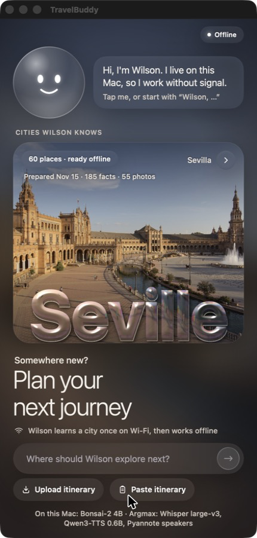
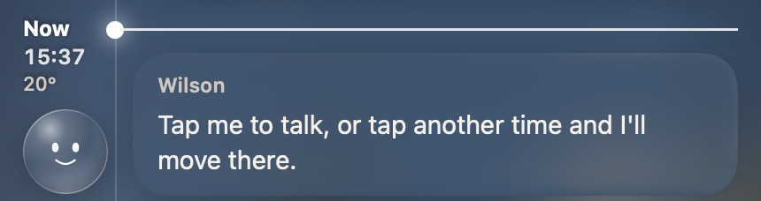
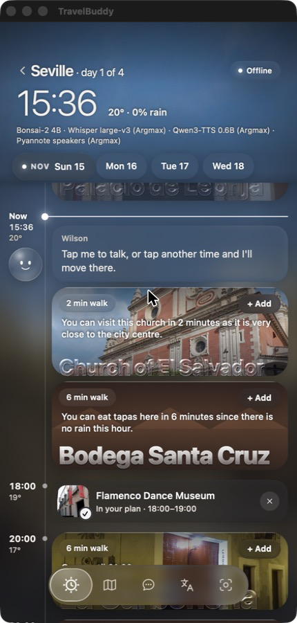
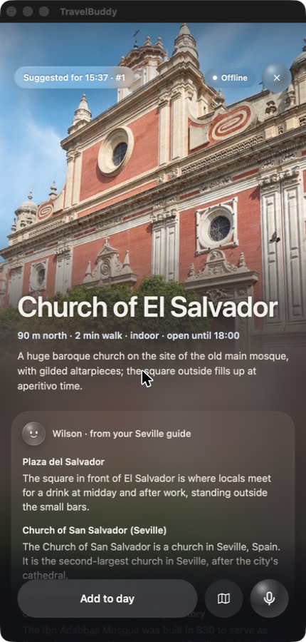
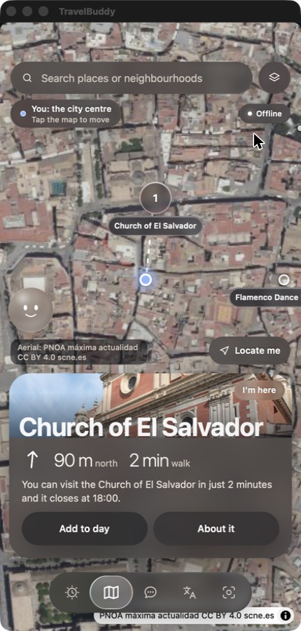
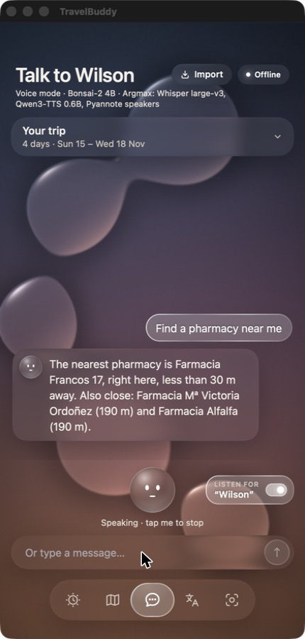
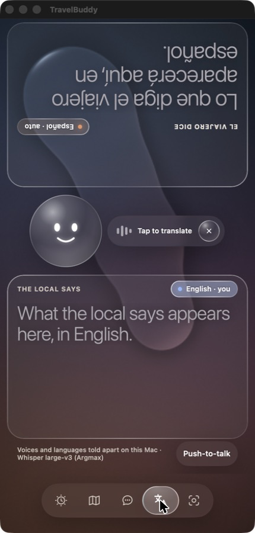
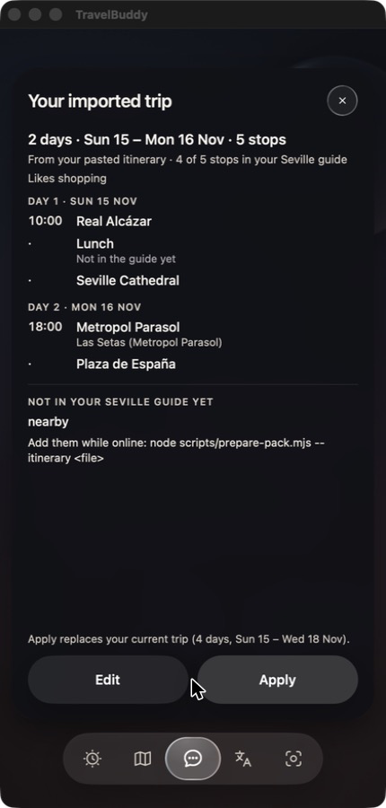

# Wilson

**An offline travel companion that lives on your Mac.** Wilson knows your trip and your city, suggests what to do next, answers out loud, reads menus and signs, and translates face to face, with Wi-Fi off. Language runs on Bonsai-2, audio on Argmax, both on this Mac.

<p align="center">
  
</p>

The repository, the Xcode scheme (`TravelBuddy-macOS`) and the support folders still use the working name Travel Buddy. What we set out to build: [SPEC.md](SPEC.md); who built what: [PLAN.md](PLAN.md).

<!-- TODO before submitting: team member names and the demo video link. -->

## What Wilson does

### Home

Wilson says hello: "Hi, I'm Wilson. I live on this Mac, so I work without signal." Tap him to talk. **Cities Wilson knows** shows each city prepared on this Mac as a photo card (Seville today) with how many places, facts and photos its guide holds and when it was prepared; tap the card to open the city. **Plan your next journey** asks where Wilson should go next: a city he knows opens, a question goes to him, and any other city gets a note on how he learns one (once, while online: facts, photos, maps, weather; then offline, see [Prepare a city](#prepare-a-city-or-import-an-itinerary)) with the command to copy. **Upload itinerary** and **Paste itinerary** (or a file dropped on the window) take an `.ics` calendar or text. When its places are Seville's it becomes your trip and Seville opens; otherwise nothing is added and the note says which city it looks like.

<table>
  <tr>
    <td align="center" width="33%"><br><sub><b>Wilson</b></sub></td>
    <td align="center" width="33%"><br><sub><b>Now</b></sub></td>
    <td align="center" width="33%"><br><sub><b>Place</b></sub></td>
  </tr>
</table>

### Wilson

A liquid-glass orb with a face of light. His mood is the app's state: idle, waking, listening, thinking, speaking, happy or unsure. On Now he rides the "now" line of the day's timeline; on the other main screens he floats over the page, and you can drag him anywhere: he moves like liquid glass and settles at the nearest side. Tap him to talk without leaving the page.

- **"Wilson, …"**: start a sentence with his name ("Wilson, where's the nearest pharmacy?", or "Hey Wilson, …") and he answers without a tap; his name alone gets "Yes?" and he listens. Argmax's Whisper reads each sentence on this Mac, with no network. He listens for his name only while he is idle and not on Translate, and the **Listen for "Wilson"** switch on Chat turns it off.
- **Call and response**: after a spoken answer he listens for a follow-up for 6 seconds, so you don't repeat his name every turn. Silence, "Thanks, Wilson" or "That's all" ends the exchange.
- **No pauses**: he starts speaking on the first finished sentence while Bonsai-2 writes the rest, with no gap between sentences.

### Now

Your trip by day: a strip of the trip's days, and the chosen day as a timeline of planned stops and suggestions for each free time. Code ranks the city's places by walking distance, opening hours, the saved weather forecast, time of day and your interests; for right now, Bonsai-2 picks among the top places and writes one line on why. Place names sit in liquid glass over each place's photo, and the city photo for the time of day fills the screen as an ambient backdrop.

- **A live clock.** The clock is Seville's real time, worked out offline from the Mac's clock, the city's UTC offset in `destination.json` and EU summer time. It ticks every minute, and the suggestions refresh each quarter hour (and when you move or the plan changes). Tap a time, or drag Wilson to it, and the clock moves there and keeps ticking from that point; **Back to real time** returns to now.
- **Editing the day.** Planned stops are compact rows with a ✓ badge, "In your plan" (or "Booked") and an ✕ to take them off. Suggestions are photo cards with **+ Add**, which puts the place in the day on screen at that row's time. A small key says which is which. Every add or remove shows "Added … · Undo" (or "Removed … · Undo") for 6 seconds.

### Place

The place's photo, how far it is and whether it is open, a short summary, then every fact the guide has. Facts from Wikipedia carry their credit and article link. Ask Wilson about the place, by voice or with a suggested question, and the answer streams onto the card as he speaks it. **Add to day** asks which day first when there is more than one to choose; once the place is planned the button reads "✓ Mon 16 · Remove" (or "✓ Today · Remove") and takes it off again. Both show the same Undo note as Now. **Map** shows the place on the map.

<table>
  <tr>
    <td align="center" width="33%"><br><sub><b>Map</b></sub></td>
    <td align="center" width="33%"><br><sub><b>Chat</b></sub></td>
    <td align="center" width="33%"><br><sub><b>Translate</b></sub></td>
  </tr>
</table>

### Map

An offline vector map of the city with three layers: **Dark**, **Light** and **Aerial** (Spain's PNOA orthophotos). Search the guide's places, then focus one or tap **I'm here**. **Locate me** asks macOS where the Mac is; when it can't say, Wilson uses the last fix he saved, and you can tap the map to set where you are.

### Chat

Talk or type to Wilson. Describe your trip in your own words ("I'm here three days, staying near the old town, I love street food and architecture") and Bonsai-2 turns it into days. Ask about the city and he answers from the guide, and says so when the guide doesn't know. Change the trip ("I'm staying two more days") and the days update. The guide facts each answer used show under it.

Ask for everyday things near you or near a place ("find a pharmacy", "is there a cash machine near the cathedral?", "a cinema open now") and code answers from the city's offline index of everything on the map (`nearby.json`, [below](#prepare-a-city-or-import-an-itinerary)): the nearest one with its distance, direction, walking time and opening hours when OpenStreetMap has them, and up to two more close by. Names and distances come from the index, never from the model, and it works the same by voice.

### Translate

For talking face to face across the Mac. The top half faces the other person, turned upside down so it reads the right way up for them. Their language is detected automatically among the ten Wilson's voice speaks (English, Spanish, French, German, Italian, Portuguese, Russian, Chinese, Japanese, Korean), or you pick it. Argmax transcribes and tells the two speakers apart, Bonsai-2 translates each sentence, and the translation is spoken. Each half lights up while its person (or its translation) is speaking. Push-to-talk is there as a fallback.

<table>
  <tr>
    <td align="center" width="33%"><br><sub><b>Import</b></sub></td>
    <td width="33%"></td>
    <td width="33%"></td>
  </tr>
</table>

### Scan

Point the Mac's camera at a dish, a sign or a menu and press the shutter. Bonsai-2's vision says what it is, translates any writing into English and gives a tip, and names a guide place when it recognises one. **Ask about it** takes a spoken question about the photo. Only the photo you take goes to the model, on this Mac.

### Itinerary import

Paste an itinerary, open a `.ics` or `.txt` file, or drop one on Chat. Calendars are read in plain code; text goes through Bonsai-2 a day at a time. A sheet shows the days, the stops and any places the guide doesn't know yet before **Apply** makes it your trip. Places the guide lacks can be added while online with `prepare-pack.mjs --itinerary` ([below](#prepare-a-city-or-import-an-itinerary)).

## How it works

Everything runs on the Mac, in three processes that talk over 127.0.0.1:

| Process | What runs in it | Where |
|---|---|---|
| The app | React Native for macOS (react-native-macos 0.81), TypeScript: screens, trip logic, ranking, the guide, prompts, the offline map (MapLibre GL JS in a web view). Liquid Glass on macOS 26, a blur before that | `app/` |
| `llama-server` | **Bonsai-2 4B** (PrismML) with its vision projector, through PrismML's llama.cpp fork, on `127.0.0.1:8080` | fetched by `scripts/fetch-models.sh` |
| `buddy-audio` | Swift helper running **Argmax**: WhisperKit (Whisper large-v3, Argmax's 626 MB `large-v3-v20240930` build) for speech-to-text, TTSKit (Qwen3-TTS 0.6B) for the voice, SpeakerKit (pyannote) to tell speakers apart. It also owns the camera and macOS Location. On `ws://127.0.0.1:8765` | `audio-helper/` (Apple Silicon) |

A spoken question goes: microphone → `buddy-audio` (Whisper) → the app (intent, guide search and ranking in code) → Bonsai-2 (streamed) → the app splits whole sentences → `buddy-audio` (TTSKit) → speaker.

- **No network at runtime.** The app and the helpers talk only to each other. Wi-Fi is used only to download the models once and to prepare a city; a network call at runtime is a bug.
- **Bonsai-2 for language, Argmax for audio.** Nothing else writes text or speaks.
- **Code does the arithmetic.** Distances, opening hours, weather and times are computed in TypeScript. Bonsai-2 chooses among the top candidates (a JSON schema limits it to that list) and explains; every place comes from the guide or the nearby index, never from the model's memory.
- **The model never picks images.** Photos come with the city pack; code picks the city photo from the clock and the on-device sunrise and sunset.
- **The Offline chip and the on-device model names stay on screen.**
- If `llama-server` or `buddy-audio` isn't running, the app still opens: typed input replaces the microphone, and recorded answers replace the model.

## Set up (once, online)

Needs an Apple Silicon Mac for the voice (on Intel the app uses typed input), macOS 15 or newer (macOS 26 for Liquid Glass), Xcode 16.1 or newer (full Xcode, not just the Command Line Tools: `sudo xcode-select -s /Applications/Xcode.app/Contents/Developer`), Node 20.19.4 or newer, and CocoaPods.

```bash
cd app && npm install && cd macos && pod install && cd ../..
```

```bash
BONSAI_MODEL=4B scripts/fetch-models.sh
```

```bash
node scripts/prepare-pack.mjs
```

- `fetch-models.sh` gets Bonsai-2 and `llama-server` through PrismML's Bonsai-demo setup, including the vision projector (`*mmproj*.gguf`) that Scan needs. On Apple Silicon it builds `buddy-audio` and runs `BuddyAudio --prepare`, which downloads the Argmax models and writes a manifest so they load with Wi-Fi off.
- `prepare-pack.mjs` prepares the city (see [below](#prepare-a-city-or-import-an-itinerary)). Facts, photos, the forecast and the nearby index are committed, so a fresh clone only needs the map tiles and aerial photos: `node scripts/prepare-pack.mjs --skip facts,more-facts,photos,forecast,nearby`.
- Argmax Pro mode (`BuddyAudio --pro`, optional) reads its key from `ARGMAX_API_KEY` or `~/.travelbuddy/argmax-key`, never from the repository; never commit it. See [audio-helper/README.md](audio-helper/README.md#argmax-pro-mode-live-speaker-labels).
- Wilson is the `'dusk'` design: check that `UI_DESIGN` in `app/src/config.ts` is `'dusk'` (`'classic'` is the earlier three-column layout).

## Run (Wi-Fi off is fine)

```bash
scripts/start.sh
```

It starts `llama-server` (Bonsai-2 4B, with its vision projector when there is one), `buddy-audio` and Metro (React Native's JavaScript server), waits for the model and warms it, says whether Bonsai-2 can see images, then builds and opens the app. `scripts/start.sh --app path/to/TravelBuddy.app` opens a built app instead. Ctrl-C stops everything. Logs go to `~/Library/Application Support/TravelBuddy/logs/`. Before a demo, `scripts/preflight.sh` (with `start.sh` running) checks that Wi-Fi is off, nothing online is reachable, and both helpers and their models are ready.

The first time, macOS asks for permissions. The helper owns the microphone, the camera and Location, so the app itself needs none of these entitlements.

- **Microphone**, and **camera** when you first open Scan: macOS asks the app that started `buddy-audio` (your terminal).
- **Location**, for Locate me: macOS asks for "Travel Buddy audio helper". macOS only asks on behalf of an app bundle, so the helper runs itself from `~/Library/Application Support/TravelBuddy/BuddyAudio.app`, and macOS asks again after each rebuild of the helper. A Mac has no GPS: macOS works out where it is from the Wi-Fi networks it can see, so the Wi-Fi radio must be on (not joined to a network). With it off, Wilson uses the last fix he saved, or a tap on the map. Details: [audio-helper/README.md](audio-helper/README.md#location).
- **Scan** needs the vision projector next to the model; `start.sh` says whether it found one and how to get it if not.

To work on the app without the helpers: `cd app && npm start` in one terminal and `cd app && npm run macos` in another.

## Prepare a city or import an itinerary

**Prepare before you travel.** Wilson is built to download a city once, on Wi-Fi, and then work as an offline guide with Wi-Fi off. `prepare-pack.mjs` saves the city's facts, photos, map, aerial photos, nearby places and forecast into the app. The app itself only talks to the model and the audio helper on your Mac, so nothing is fetched while you use it. Preparing takes a while, so do it at home or at the hotel on Wi-Fi before you set out, not on the go.

| Preparing | Time | With `WIKIMEDIA_CONTACT` (estimated) |
|---|---|---|
| Each place (its facts and photo, plus more facts in a full run) | about 25 seconds | 2-3 seconds |
| A new city of 30 places | about 17-20 minutes | about 4-6 minutes |
| A new city of 60 places, like Seville | about 30-35 minutes | about 5-8 minutes |
| An itinerary with 5 places the guide lacks | about 3 minutes | about 1 minute |
| An itinerary with 15 places the guide lacks | about 6-8 minutes | about 1-1.5 minutes |
| Running it again with the same `--cache <dir>` | 1-2 minutes | 1-2 minutes |

Most of that time is spent waiting for Wikimedia. It lets clients without contact details make 10 requests a minute, so the facts, more-facts and photos steps send one every 6.5 seconds, about four for each place. With `WIKIMEDIA_CONTACT=you@example.org node scripts/prepare-pack.mjs` they may make 200 a minute; the address goes only into the User-Agent sent to Wikimedia. If Wikimedia still asks them to slow down, that step goes back to one request every 6.5 seconds. Photo downloads stay at one a second either way, and the other steps don't depend on the contact. A new city also needs about 3-4.5 minutes for the map tiles, nearby places, aerial photos and forecast, however many places it has. Outside Spain, which the aerial photos don't cover, that is about 3 minutes less. An itinerary needs about 40 seconds to look its places up in OpenStreetMap, and up to 75 seconds more when OpenStreetMap is busy.

`node scripts/prepare-pack.mjs` runs seven steps in order, reports each, and carries on past one that fails:

1. `facts` (`fetch-facts.mjs`): each place's Wikipedia article (English, else Spanish), checked against the place's name, location and kind, saved as a short fact with its source. Fix a wrong or missing match in `app/src/pack/seville/wiki-overrides.json` (`"<placeId>": "en:Article title"`, or `null` for no fact).
2. `more-facts` (`deepen-facts.mjs`): up to three more facts per place from the rest of the matched article (the lead's later paragraphs, then sections such as History or Architecture), each titled `<Article>: <Section>` with the same source and licence, so "tell me more about the cathedral" has an answer offline.
3. `photos` (`build-photos.mjs`): one photo per place (the matched article's main image, else a Commons search) at 1200 px, and the four time-of-day city photos at 1600 px, picked from the place photos. Fix a bad pick in `app/src/pack/seville/photos/overrides.json`.
4. `forecast` (`fetch-forecast.mjs`): a 7-day hourly forecast. The app shows its age offline.
5. `tiles` (`build-tiles.mjs`): OpenStreetMap vector tiles for the city (gitignored, so run it on every clone). Without them the map shows pins only.
6. `nearby` (`build-nearby.mjs`): `app/src/pack/seville/nearby.json`, every named point of interest in the tiles inside the city's bounds (cinemas, pharmacies, cash machines, supermarkets, …) plus unnamed cash machines and toilets, with opening hours and cuisine added from one Overpass query (`--no-osm` skips it). It needs the tiles. `app/src/core/nearby.ts` searches it for "find X near me".
7. `aerial` (`build-aerial.mjs`): aerial photo tiles for the map's Aerial layer (gitignored too; the source covers Spain only). Without them that layer is unavailable.

It then writes `app/src/pack/seville/prepared.json` (when it was prepared and what the pack holds), which the home's city card reads ("60 places · ready offline").

The Seville pack now holds 60 places, 185 facts (37 written for the guide, 44 Wikipedia lead facts and 104 more from article sections) and 5,861 nearby places.

- Each step also runs on its own, e.g. `node scripts/fetch-facts.mjs --dry-run`. Skip steps with `--skip facts,more-facts,photos,forecast,tiles,nearby,aerial` (any of them). `--cache <dir>` reuses answers from an earlier run: Wikimedia's, OpenStreetMap's in `<dir>/osm` and the aerial tiles in `<dir>/aerial`.
- `--dest <id>` prepares another pack folder, `app/src/pack/<id>/`, which needs at least `places.json` and `destination.json`. Seville is the pack the app ships with.

**An itinerary with places the guide lacks.** In the app, Import on Chat reads an itinerary offline and lists the places it names that the guide doesn't have. Give the same file to the preparation script while you are still online:

```bash
node scripts/prepare-pack.mjs --itinerary ~/Downloads/seville-trip.ics   # or a .txt itinerary
```

- `--itinerary <file>` reads an iCalendar export (Google Calendar, Apple Calendar) or a plain-text itinerary ("Day 1", "10:00 Lunch at Eslava", …) and finds the places in it that the pack does not have. For each event it takes Apple's place title, the first part of LOCATION unless that is a street address, and SUMMARY without the activity; it skips flights, trains and transfers, and never reads DESCRIPTION. `node scripts/itinerary.mjs <file>` shows the same list offline, without changing anything.
- It looks those names up in OpenStreetMap inside the city's bounds (`fetch-places.mjs --match`: one Overpass query, then Nominatim, at most one request a second, for names Overpass misses) and adds what it finds to `app/src/pack/seville/places.json` with `"needsReview": true`: category, interest tags, indoor, visit length and opening hours come from OSM's tags, the neighbourhood from the nearest pack place, and the itinerary's wording becomes an alias when it differs from the name. A name that turns out to be a pack place under another name only becomes an alias of it.
- Then the facts and photos steps run for the new places only, and each new place's summary becomes the first sentence or two of its Wikipedia fact. The more-facts, forecast, tiles, nearby and aerial steps do not run; run `prepare-pack.mjs` without `--itinerary` for those.
- `prepared.json` records the run as `"itinerary": { "file", "added": [ids], "notFound": [names] }`. Running the same file again adds nothing twice and retries facts and photos for places it added that still lack them. Check the new places (category, hours, summary in Spanish when English Wikipedia has no article), delete `needsReview`, and reload the app so Metro serves the new `places.json`.

## Develop

```bash
cd app
npm test            # Jest: the core logic in Node, plus screen tests (512 tests in 31 suites)
npm run typecheck   # tsc --noEmit
npm run lint        # ESLint
```

With `llama-server` running: `npm run test:live` runs the live model checks, and `npm run eval` checks the demo's model calls against the real Bonsai-2 (it writes `docs/eval/<model>.md` and refreshes the recorded answers). The audio helper builds with `cd audio-helper && swift build -c release`, and `node scripts/test-audio.mjs speak|listen|conversation` tests it from the terminal (Node 22 or newer).

| Path | What |
|---|---|
| `app/src/core/` | Plain TypeScript with no React Native imports, tested in Node: trip and intent, the companion loop, scoring and recommendations, the day plan, the guide, the nearby search (`nearby.ts`), translation, vision, itinerary import, sun and time (the city clock is `cityClock()` in `time.ts`) |
| `app/src/services/` | The `llama-server` client (streaming), the `buddy-audio` WebSocket client and protocol, the wake word's text rules (`audio/wake.ts`, mirrored in the helper's `Wake.swift`), typed and recorded stand-ins |
| `app/src/ui/screens/` | The screens, and `WilsonLive.tsx`, which gives them Wilson's face, mood and voice level. Some keep their first names: Home is `WelcomeScreen`, Chat is `SetupScreen` (`'setup'`), Translate is `TalkScreen` (`'talk'`), Scan is `LookScreen` (`'look'`) |
| `app/src/ui/dusk/` | Wilson's face and moods (`Wilson.tsx`), the floating Wilson (`Buddy.tsx`), the city cards (`CityCard.tsx`), the Undo note (`UndoToast.tsx`), glass, the tab bar, backdrops, the import sheet, design tokens |
| `app/src/ui/useBuddy.ts` | The one loop every screen reads: typed text and the microphone both go through `send()`; it also keeps the live clock and the wake word. Call and response is `voiceLoop.ts` |
| `app/src/map/` | The offline map (MapLibre GL JS in a web view) and its generated tiles |
| `app/src/pack/seville/` | The Seville guide: places, facts, phrases, forecast, photos, the nearby index (`nearby.json`), `prepared.json` |
| `app/macos/` | The Xcode project (scheme `TravelBuddy-macOS`); native glass and the file panel live in `AppDelegate.mm` |
| `audio-helper/` | `buddy-audio`: Argmax, camera, Location ([README](audio-helper/README.md)) |
| `scripts/` | Setup, start, preflight, and the pack preparation scripts |

To add a place by hand, look it up in OpenStreetMap with `node scripts/fetch-places.mjs --compact "Place name"`. [docs/PACK-CHECKLIST.md](docs/PACK-CHECKLIST.md) lists what still needs checking in the pack, and [docs/HANDOFF.md](docs/HANDOFF.md) the rules the code keeps (no runtime network, `useScreenSize()` not `useWindowDimensions`, fonts and colours from the tokens).

## Credits and licences

Licences of what the city pack and the app contain:

| Data | Source | Licence |
|---|---|---|
| Place facts marked with a source | Wikipedia | CC BY-SA 4.0 (each fact keeps its article URL) |
| Photos | Wikimedia Commons | Per photo (CC0, public domain, CC BY or CC BY-SA), with author and file page in `places.json` and `destination.json` |
| Map tiles | OpenStreetMap contributors, via Protomaps | ODbL |
| Places added by `--itinerary` (names, coordinates, hours; each keeps its OSM element in `osm.ref`) | OpenStreetMap contributors | ODbL |
| Nearby index (`nearby.json`: names, kinds, positions, opening hours) | OpenStreetMap contributors, via Protomaps tiles and Overpass | ODbL |
| Aerial photos (map's Aerial layer, `scripts/build-aerial.mjs`) | Instituto Geográfico Nacional, PNOA máxima actualidad orthophotos (WMTS), credited on the map as "PNOA máxima actualidad CC BY 4.0 scne.es" | CC BY 4.0 |
| Forecast | Open-Meteo.com | CC BY 4.0 |
| Manrope font | The Manrope Project Authors | SIL Open Font Licence 1.1 (`app/assets/fonts/OFL.txt`) |

Map data © OpenStreetMap contributors (ODbL), tiles via Protomaps, aerial photos © Instituto Geográfico Nacional (PNOA, CC BY 4.0). Forecast from Open-Meteo.com (CC BY 4.0). Place texts from Wikipedia (CC BY-SA 4.0). Photos from Wikimedia Commons, each under its own licence with its author credited in the pack.

Bonsai-2 by PrismML. Speech, voice and speaker recognition by Argmax: WhisperKit (Whisper large-v3), TTSKit (Qwen3-TTS 0.6B) and SpeakerKit (pyannote). Map drawn with MapLibre GL JS and PMTiles (BSD-3-Clause). Built with React Native for macOS, react-native-svg, react-native-webview and MiniSearch (MIT). The glass follows liquid-glass-react, liquid-glass-studio and ektogamat/apple-liquid-glass.
